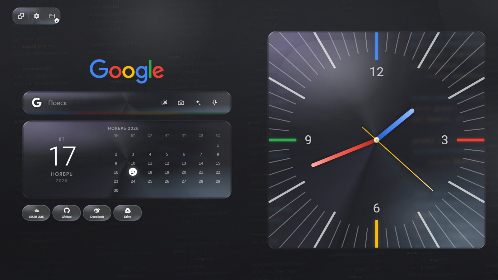
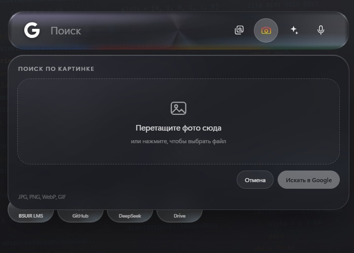
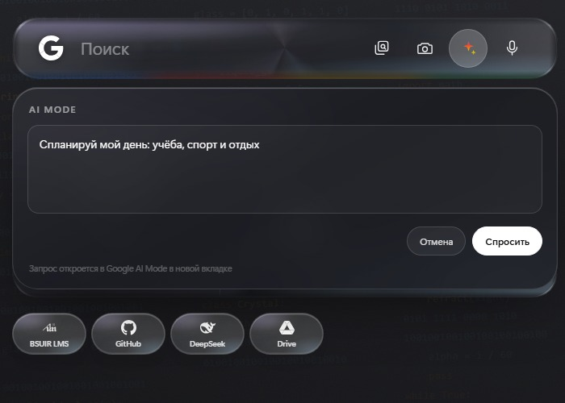
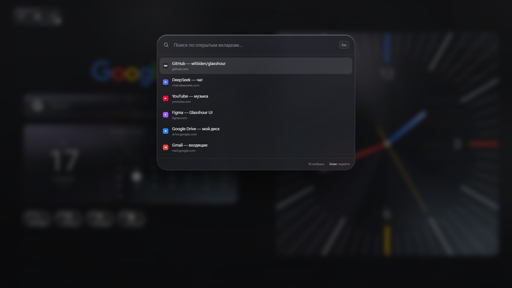
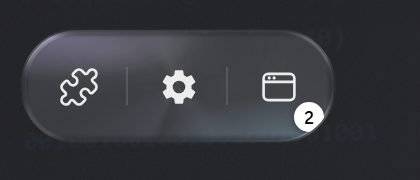

# Glasshour — a liquid-glass new tab for Chrome

[](LICENSE)

> **glass + hour** — glass, time, and a calmer start page.

**Glasshour** is an opinionated Chrome new tab page inspired by Apple's **Liquid Glass** aesthetic: translucent panels, dark graphite tones, an analog clock, a calendar, Google search, and quick links. It is built with vanilla HTML, CSS, and JavaScript — no framework and no build step.

Palette: black, dark gray, graphite, white, and Google accents.



## Why Glasshour

The name combines **glass** and **hour** — a nod to the hourglass, the glass clock face, and the moment a new tab begins. Short, individual, and not a direct copy of Apple's design-language name.

## Installation

1. Open `chrome://extensions`.
2. Enable **Developer mode** in the top-right corner.
3. Click **Load unpacked**.
4. Select the project folder (for example, `C:\Users\arden\Documents\chrome_template`).
5. Open a new tab — Glasshour will replace the default page.

After editing files, click **Reload** on `chrome://extensions`.

Tab search requires the `tabs` permission, which is already declared in `manifest.json`. Window switching uses the `chrome.windows` API and needs no extra permission.

Without the extension, `index.html` opens as a regular page, but `chrome://` buttons and Chrome window switching are unavailable.

## Features

### Time and date

- **iOS-style analog clock** — a square glass panel with the same edges as the other cards and no inner outline. Ticks start at the panel edges, numerals are 12 / 3 / 6 / 9, hour and minute hands are thick, and the thin second hand has a tail and a center dot. The clock updates once per second.
- **Calendar** — a wide card below the search bar: the current weekday, day, month, and year on the left; a full-month grid with today highlighted on the right. Quick links sit below the calendar.

### Search

- **Google wordmark** — the official color logo with the brand typography, centered above the search bar. It is 30% larger, and the area around it is completely transparent; the logo sits above the background layers.
- **Search bar** — the same width as the calendar and 30% shorter than before. It contains a white Google icon and four white tool buttons: open tabs, image search, AI Mode, and voice input.
- **Bottom glow** — a very thin, pale, semi-transparent glow in Google colors. It is clipped exactly to the search card, reaches the side edges, and follows the rounded corners.
- **Image search** — the camera button opens an in-page glass panel with a drop zone, file picker, and preview. After a file is loaded, the drop zone is replaced by **Choose another photo** and **Clear**. The active button gets a static circular backing and Google-colored icon.
- **AI Mode** — opens an in-page panel with a question field. **Ask** sends the query to Google AI Mode in a new tab. The active button uses the same static circular backing and Google colors.
- **Voice input** — while listening, the microphone circle pulses and the icon turns Google-colored. It is the only pulsing button on the page.

### Chrome

- **Top block** — one shared glass capsule in the top-left corner, away from the clock:
  - extension management — `chrome://extensions`;
  - Chrome settings — `chrome://settings`;
  - Chrome window switching.
- **Window switching** — the third button shows a window icon and a white open-window count. A click focuses the next Chrome window, restores it if minimized, and wraps back to the first window after the last one. With a single window the button is disabled. It works for windows in the **same Chrome profile**; the order is deterministic, by window ID.
- **Tab search** — the tabs button in the search bar opens a glass overlay with the list of open tabs. Filter by title or URL, navigate with ↑/↓, press Enter to switch, and Esc to close. Requires the `tabs` permission.

### Look and feel

- **Quick links** — compact dark tiles for BSUIR LMS, GitHub, DeepSeek, and Google Drive, each with a white logo and a short label.
- **Glass lens** — the background behind the cards is blurred and magnified, with soft purple and blue highlights near the edges. All hover effects are disabled.
- **Background** — Python code and binary strings with PyCharm Darcula syntax colors: orange keywords, green strings, blue numbers, and yellow functions. The whole page is dimmed.
- **Responsive layout** — on narrow screens the clock and cards stack vertically; the top block stays above the clock.

### Controls

- `/` or `Ctrl/⌘ + K` — focus the search bar.
- `Enter` — run the search.
- `Esc` — close the image/AI panel or clear the input.
- `↑` / `↓` and `Enter` — navigate the open-tabs overlay.

## Screenshots

### Image search



### AI Mode



### Open-tab search



### Top Chrome block



*Extensions, Chrome settings, and window switching live in one glass capsule.*

## Performance

Glasshour is designed for modest CPUs and low memory usage:

- the clock updates **once per second** instead of 60 times via `requestAnimationFrame`;
- the background is static: no infinite animations and no heavy light-blob blur;
- glass uses a 20 px blur instead of 34 px;
- quick-link tiles have no `backdrop-filter` or masks;
- the magnified code layer exists only on the clock, search bar, and calendar;
- the number of code lines adapts to the screen size;
- all hover effects are removed: no `pointermove`, no per-frame highlights, no card lift;
- **0 active CSS animations at rest**; only the microphone pulses while listening.

Reference measurement in headless Chrome at 1920×1080: about **1 MB JS heap** and **0 running animations** after load. Results vary by system.

## Limitations

- Window switching only works between windows of the **same Chrome profile**. Windows from another profile or a separate browser instance are not visible to the extension.
- Chrome does not expose Alt+Tab z-order, so windows are switched in a stable order by window ID.
- `chrome://extensions` and `chrome://settings` links only work in extension mode; regular `file://` pages cannot open them.
- Tab search requires the `tabs` permission.
- The project targets Chrome/Chromium with Manifest V3.
- The UI copy is currently in Russian; the code is structured so it can be translated.

## Tech stack

- Chrome Manifest V3
- Vanilla HTML, CSS, and JavaScript
- No dependencies and no build step
- Local assets: Roboto fonts, Google wordmark, icons, and the code-lens texture

## Configuration

| What | Where |
| --- | --- |
| Search provider | `script.js`, `SEARCH_URL` |
| AI Mode URL | `script.js`, `AI_URL` |
| Clock size | `styles.css`, `--clock-size` |
| Page edge spacing | `styles.css`, `--edge` |
| Shared card radius | `styles.css`, `--card-r` |
| Google wordmark size | `styles.css`, `.google-brand img` |
| Search glow colors | `styles.css`, `.search__google-line` |
| Top block position | `styles.css`, `.topbar` |
| Top button URLs | `script.js`, `openChromePage(...)` |
| Window switching | `script.js`, `focusNextWindow(...)` |
| Glass edge fade | `--fade` on `.glass` and individual cards |
| Page dimming | `.dim` in `styles.css` |
| Quick links and labels | `index.html`, `nav.links` |
| Logos and fonts | `assets/` |
| Magnified background | `assets/code-lens.svg` + `.lens` |
| Color highlights | `.chroma` (static, no hover) |
| Background code text | `CODE_LINES` in `script.js` |

## Project structure

```text
manifest.json      — Chrome extension manifest (MV3)
index.html         — new tab page markup
styles.css         — glass, lighting, layout, responsive styles
script.js          — clock, calendar, search, windows, tabs, background
assets/            — logos, Roboto fonts, lens texture, Google wordmark
docs/screenshots/  — README screenshots
LICENSE            — MIT license
README.md          — this file
```

## Privacy

Glasshour collects no analytics and sends no data to third-party servers on its own. Network requests happen only when you act: Google search, AI Mode, uploading an image to Google image search, or opening a quick link. The tab list and window list are used locally by the corresponding buttons.

## License

Released under the [MIT License](LICENSE).

Copyright (c) 2026 Glasshour contributors.

## Version

**1.11.0** — Glasshour naming, refreshed documentation, Chrome window switching, the current search styling, README screenshots, and MIT licensing.
